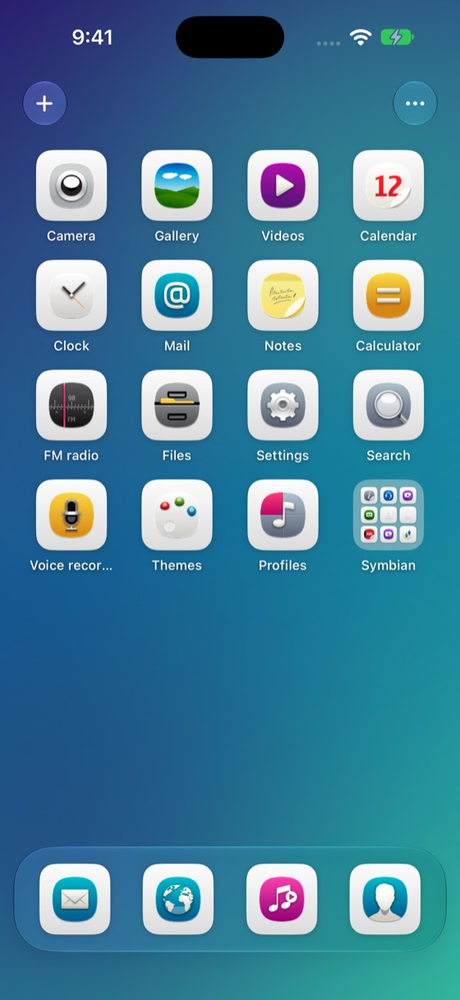
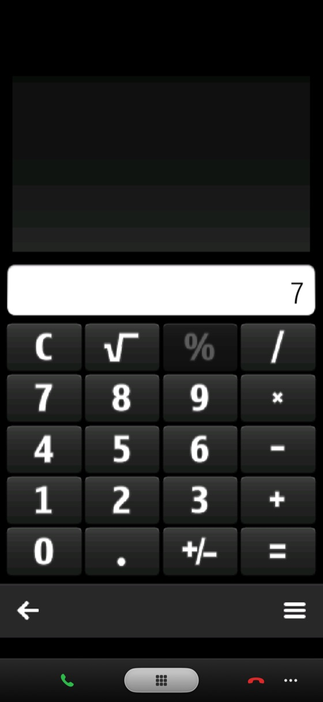
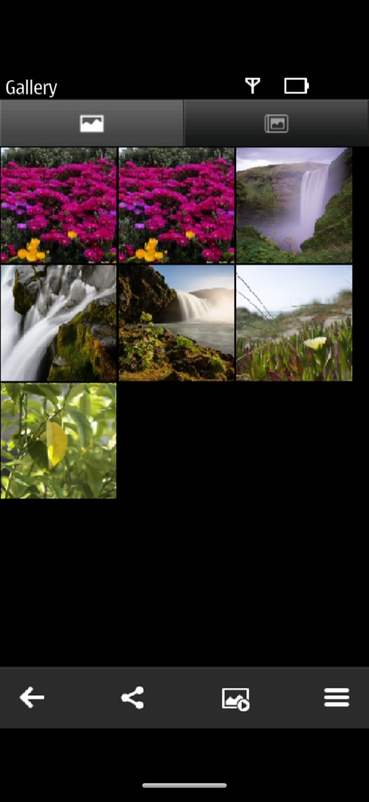
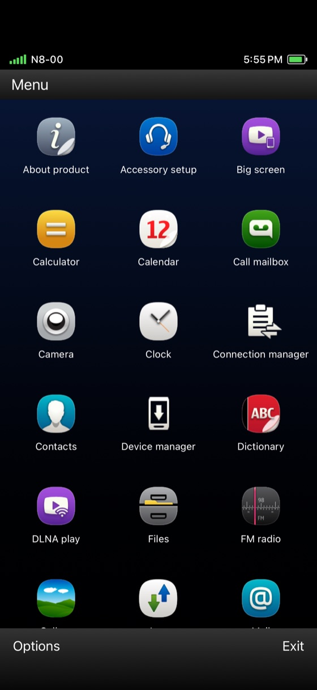

<h1 align="center">SymbianBoard</h1>

<p align="center"><b>Symbian apps on your iPhone and Mac, on a home screen that feels like iOS.</b><br>
Built on the <a href="https://github.com/EKA2L1/EKA2L1">EKA2L1</a> Symbian emulator.</p>

<p align="center">
  <a href="https://harkhowalia-1.github.io/SymbianBoard/"><b>Website</b></a> ·
  <a href="https://github.com/harkhowalia-1/SymbianBoard/releases/latest"><b>Download</b></a> ·
  <a href="#building-from-source"><b>Build from source</b></a>
</p>

<p align="center">
  
  
  
  
</p>

---

SymbianBoard runs real Symbian apps — the phone's own Calculator, Gallery, Notes,
games, and anything you install from a `.sis`/`.sisx` package — inside an emulated
Nokia phone, and puts them on a home screen that behaves like the iPhone's. Apps open
straight from their icons, keep running when you go home, and come back instantly.

## Features

- **iPhone-style home screen** — paged icon grid with the apps' real Symbian icons,
  a dock, a "Symbian" folder for the phone's built-in apps, long-press quick actions,
  and jiggle mode to rearrange or remove apps.
- **Or a Symbian home screen** — switch to a Symbian^3-style Menu (status bar, icon
  grid, Options / Exit softkeys), like running the full phone.
- **The N8's Menu key** — the silver rounded-rectangle key from the Nokia N8's body is
  always under a running app; the green and red call keys appear in the calling apps.
- **Install apps with +** — pick a `.sis` or `.sisx` file and it installs onto the phone.
- **Shortcuts** — every app has a `symbianboard://` launch link, shows up in the
  Shortcuts app ("Open Symbian App"), and can be added to the iPhone Home Screen.
- **Your iPhone's photos and music on the phone** — your newest photos appear in the
  N8's own Gallery; songs stored on the iPhone are copied for the Music player; pictures
  Symbian apps save go to your iPhone Photos.
- **On the Mac too** — the same app runs on Apple silicon Macs in a phone-shaped window,
  with the JIT always on.
- **Fast** — apps stay running behind the home screen; the dynarmic JIT is built into the
  sideload version.
- **Install firmware straight from a download** — pick the firmware `.zip` (or `.7z`) as you
  downloaded it, or an unzipped folder with the `.vpl` + `.fpsx` files (e.g. Nokia N8 RM-596),
  and it installs the device. ROM + RPKG dumps work too.

## Download

| Build | JIT | Where |
| --- | --- | --- |
| **iOS sideload IPA** | ✅ (needs a JIT enabler at run time) | [Latest release](https://github.com/harkhowalia-1/SymbianBoard/releases/latest) |
| App Store / TestFlight | ❌ (Apple doesn't allow JIT) | Not published yet |
| **Mac DMG** (Apple silicon, macOS 14+) | ✅ always on | [Latest release](https://github.com/harkhowalia-1/SymbianBoard/releases/latest) |

1. Install the IPA with [AltStore](https://altstore.io), [SideStore](https://sidestore.io) or
   [Sideloadly](https://sideloadly.io).
2. For full speed, enable JIT for SymbianBoard with SideStore or
   [StikDebug](https://github.com/StephenDev0/StikDebug). Without it the app still works,
   on the slower interpreter.
3. On first launch, install a device: **Install Device → Zip or 7z archive**, then pick the
   firmware zip (or choose **Nokia firmware (.vpl)** for an unzipped folder). Use firmware
   from a phone you own.

**On a Mac:** open the DMG and drag SymbianBoard to Applications. It isn't notarized yet, so
the first launch is blocked: open **System Settings → Privacy & Security** and click
**Open Anyway**. Then install your firmware as above.

> **Firmware is not included.** Nokia's firmware is copyrighted, so public builds ship
> without it. Personal builds can bundle a device you own for a zero-setup first launch
> (see below) — don't publish those.

## What works

Tested in the iOS simulator and on an Apple silicon Mac with a Nokia N8 (RM-596, Symbian^3) firmware.

| | Status |
| --- | --- |
| Home screen, folders, jiggle mode, Symbian Menu mode | ✅ |
| Calculator, Files, Notes and other simple apps | ✅ |
| Gallery listing iPhone photos (N8 harvester + thumbnails) | ✅ |
| Opening a single photo full screen in Gallery | ❌ crashes (being fixed) |
| Music player (songs copied from the iPhone) | ✅ |
| Mac (Apple silicon) | ✅ home screen and apps, JIT on |
| Clock | ❌ quits on launch |
| Real iPhone hardware | Not tested yet |

App compatibility follows EKA2L1's: many Symbian apps and games run, some don't.
See the [EKA2L1 compatibility list](https://github.com/EKA2L1/Compatibility-List).

## Building from source

Requires macOS with Xcode 26+ and CMake.

```sh
git clone --recurse-submodules https://github.com/harkhowalia-1/SymbianBoard
cd SymbianBoard
EKA2L1_IOS_CONFIGURATION=Release scripts/build_ios.sh simulator   # iOS simulator
EKA2L1_IOS_CONFIGURATION=Release scripts/build_ios.sh ipa         # sideload IPA with JIT
EKA2L1_IOS_DEVELOPMENT_TEAM=<team> scripts/build_ios.sh archive  # App Store build (no JIT)
scripts/package_mac.sh build/SymbianBoard-sideload.ipa SymbianBoard-mac.dmg  # Mac DMG
```

The Mac app is the arm64 iOS build re-tagged as Mac Catalyst and ad-hoc signed into the
App Sandbox; nothing is recompiled. Its data lives in
`~/Library/Containers/com.harkhowalia.symbianboard`.

**Zero-setup personal builds:** install a device once (in the simulator or on a phone),
then copy its `data/drives/z/<code>`, `data/drives/c`, `data/roms/<code>` and
`data/devices.yml` into `firmware/BundledDevice/` (git-ignored). Builds then ship that
device and boot straight to the home screen. Set `SYMBIANBOARD_BUNDLE_DEVICE=OFF` to leave
it out; `archive` always leaves it out.

### What SymbianBoard adds to EKA2L1

- `src/emu/ios/App/` — the home screens (`Springboard.swift`, `SymbianHome.swift`), N8
  control bar, shortcuts (`HomeShortcuts.swift`), first-run setup, and the iPhone media
  bridge (`MediaBridge.swift`).
- `src/emu/ios/Bridge/` — Nokia firmware (`.vpl`) install, running-app resume, host file
  events.
- Emulator core — `RTimer::Inactivity`, an emulated metadata (MDS) file server plugin so
  Symbian's media harvester sees new files, quieter release logging.

## Credits and licence

SymbianBoard is a fork of [EKA2L1](https://github.com/EKA2L1/EKA2L1) by the EKA2L1 team —
the emulator itself is their work. Like EKA2L1, SymbianBoard is licensed under the
[GNU GPL v3](LICENSE). Symbian and Nokia firmware, apps and trademarks belong to their
owners; SymbianBoard ships none of them.
